

  

<h1 align="center">Onduleurs et Qualité de l'énergie</h1>
<h3 align="center">Simulations d'onduleurs sous PSIM</h3>

  Compte rendu de TP — ENSEA 
  <strong>Alejandro MUNOZ GUTIERREZ</strong> · <strong>Houssam BEKRI</strong> — Groupe TP1

---

## Résumé

Ce dépôt rassemble le compte rendu d'un TP de simulation (logiciel **PSIM**) sur les onduleurs :

- **Onduleur monophasé** : commande pleine onde, MLI à commandes complémentaires totales, MLI à commandes décalées, dimensionnement du filtre LC de sortie, et fonctionnement réversible redresseur/onduleur avec asservissement (boucles de courant et de tension).
- **Onduleur triphasé** : charge RL, influence de $\delta\alpha$, de $\alpha_0$ et de la fréquence de découpage, puis machine asynchrone (démarrage, temps d'accélération, inversion du sens de rotation).

## Sommaire

1. [Onduleur monophasé](#1-onduleur-monophasé)
   1. [Onduleur pleine onde](#a-onduleur-pleine-onde)
   2. [MLI à commandes complémentaires totales](#b-onduleur-mli-à-commandes-complémentaires-totales)
   3. [MLI à commandes décalées](#c-onduleur-mli-à-commandes-décalées)
   4. [Réversibilité redresseur / onduleur](#d-réversibilité-redresseur--onduleur)
2. [Onduleur triphasé](#2-onduleur-triphasé)
   1. [Simulations avec charge RL](#a-simulations-avec-charge-rl)
   2. [Simulation sur machine asynchrone](#b-simulation-sur-machine-asynchrone)

---

## 1. Onduleur monophasé

### a. Onduleur pleine onde

#### Schéma de simulation

  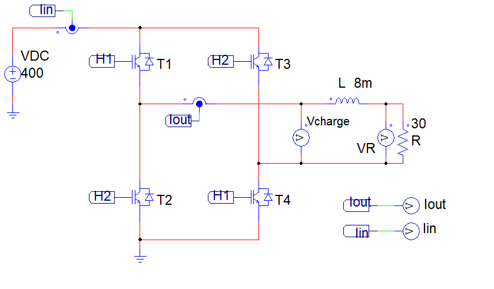 
  <em>Figure 0 : Schéma de puissance d'un onduleur monophasé avec une charge RL sur PSIM.</em>

  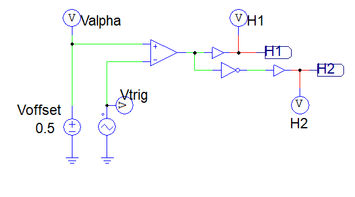 
  <em>Figure 1 : Partie contrôle/commande du schéma de puissance.</em>

  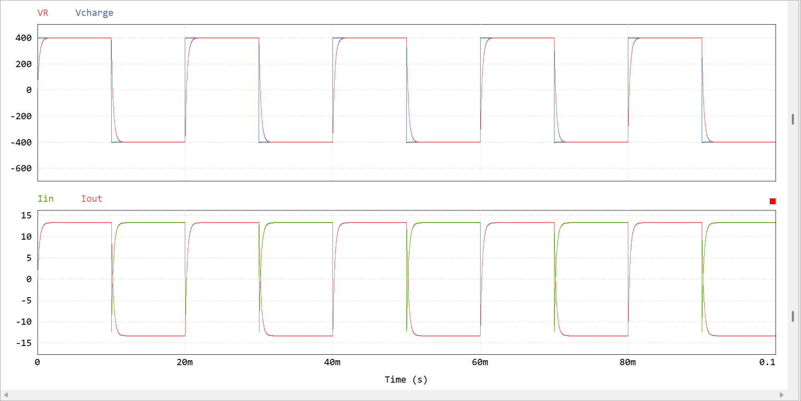 
  <em>Figure 2 : Tension aux bornes de la charge (Vcharge,VR) et courants (Iin, Iout).</em>

Le courant débité par la source de tension DC ($V_{DC}$) devient négatif, donc la source $V_{DC}$ doit obligatoirement être **réversible**.

#### Simulations

  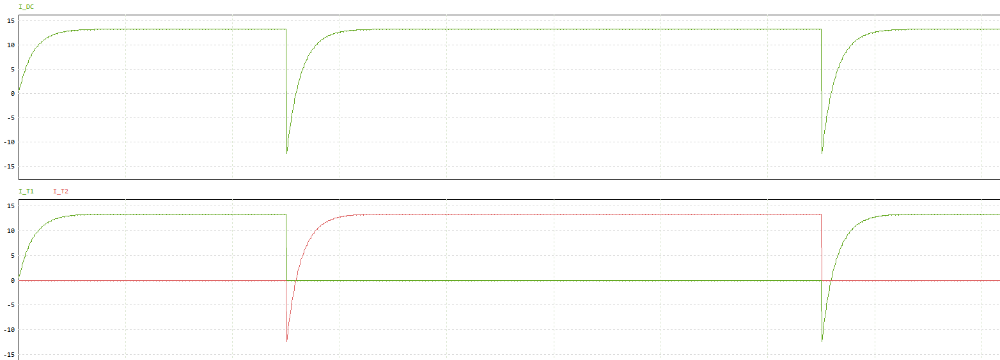 
  <em>Figure 3 : Courants dans T1 et T2 (au sens large : IGBT + diode).</em>

- **Phase 1** : le transistor T1 est ON et conduit normalement.
- **Phase 2** : T1 est OFF, la diode D2 évacue le courant de l'inductance (continuité du courant dans l'inductance).
- **Phase 3** : le transistor T2 est ON et conduit normalement.
- **Phase 4** : T2 est OFF, le courant de l'inductance est évacué par la diode D1 (continuité du courant dans l'inductance).

<table>
<tr><td align="center">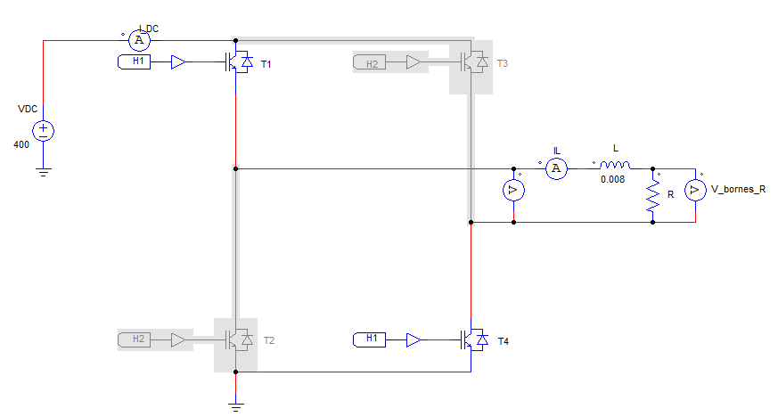 <em>Figure 4 : Phase 1.</em></td><td align="center">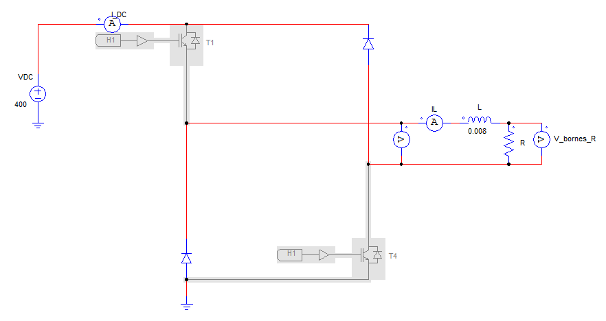 <em>Figure 5 : Phase 2.</em></td></tr>
<tr><td align="center">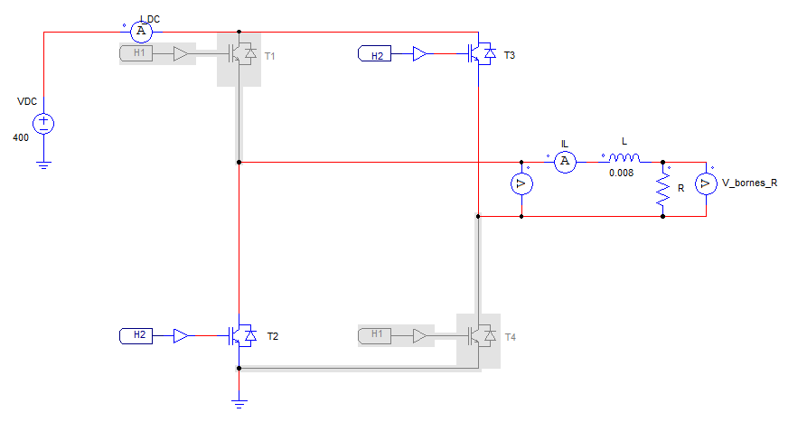 <em>Figure 6 : Phase 3.</em></td><td align="center">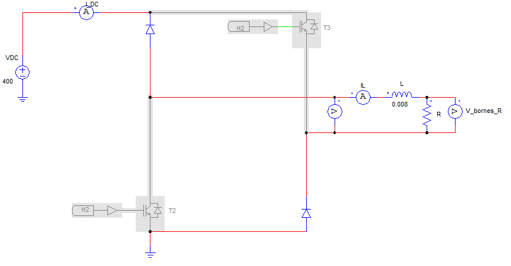 <em>Figure 7 : Phase 4.</em></td></tr>
</table>

  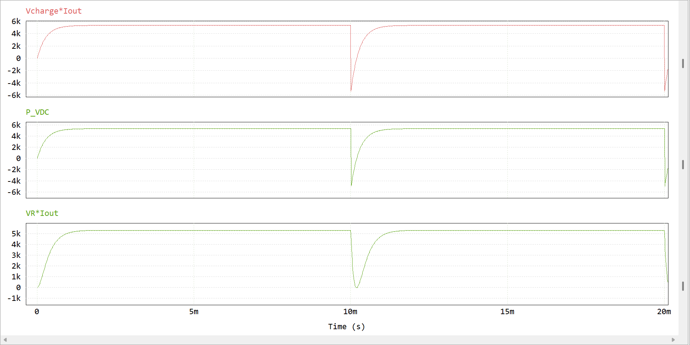 
  <em>Figure 8 : Puissances instantanées côté VDC, entre les bras de l'onduleur et côté charge R.</em>

#### FFT

  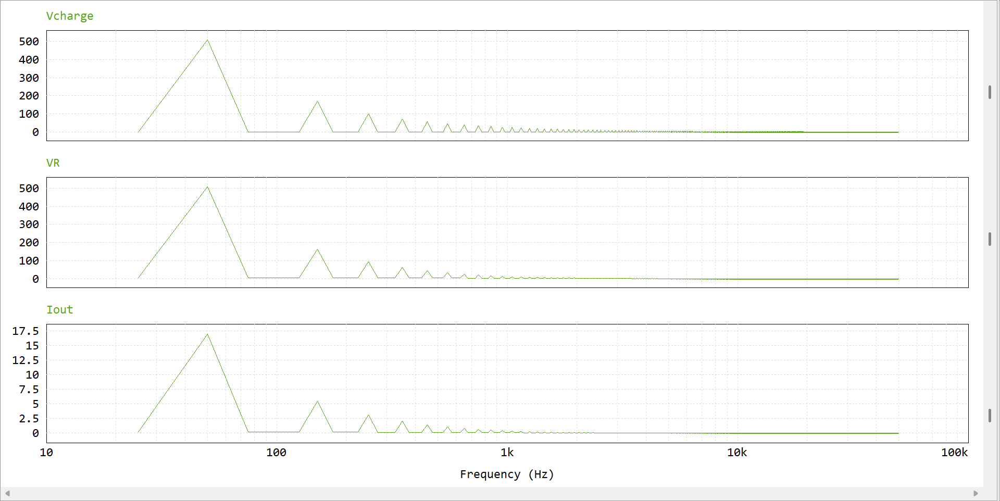 
  <em>Figure 9 : FFT des tensions de sortie (entre bras et aux bornes de R) et du courant de charge (jusqu'à 2 kHz).</em>

### b. Onduleur MLI à commandes complémentaires totales

  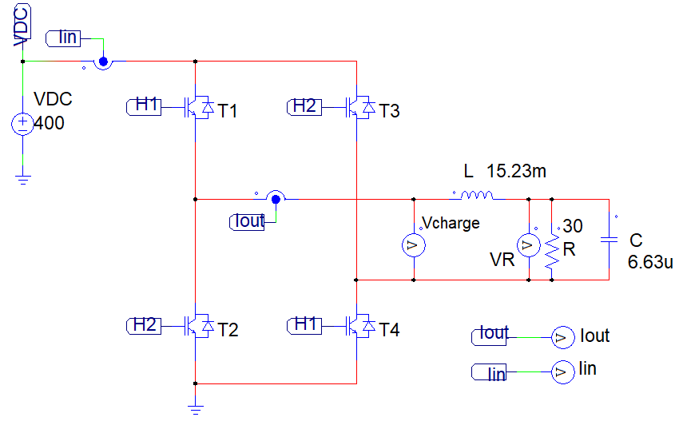 
  <em>Figure 10 : Schéma de puissance d'un onduleur monophasé avec une charge RLC sur PSIM.</em>

  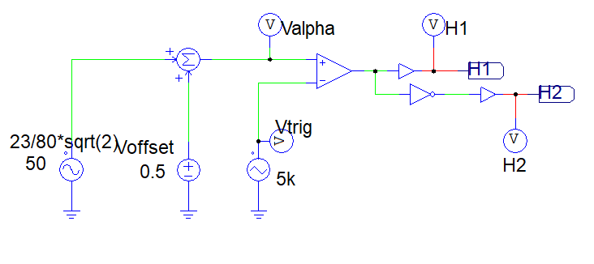 
  <em>Figure 11 : Schéma de commande permettant de générer une commande complémentaire totale des interrupteurs.</em>

#### Évolution théorique de $\alpha(t)$

$$\langle V_{out} \rangle = (2\alpha - 1)\, V_{DC}$$

Avec $\alpha = 0.5 + \delta\alpha \sin(\omega t)$ :

$$\langle V_{out} \rangle = \left[ 2\left(0.5 + \delta\alpha \sin(\omega t)\right) - 1 \right] V_{DC} = 2\,\delta\alpha \sin(\omega t)\, V_{DC}$$

Pour une valeur efficace de 230 V, avec $V_{DC} = 400$ V :

$$2\,\delta\alpha\, V_{DC} = 230\sqrt{2} \quad\Rightarrow\quad \delta\alpha = \frac{230\sqrt{2}}{2 \times 400} = 0.4065$$

Pour recréer une tension sinusoïdale de valeur efficace 230 V aux bornes de la résistance de charge, il faut donc :

$$\alpha(t) = 0.5 + 0.4065 \sin(\omega t)$$

#### Dimensionnement de L et C

On détermine L et C pour que la fréquence de cassure du filtre de sortie soit de **500 Hz** et le coefficient d'amortissement **m = 0,8**.

  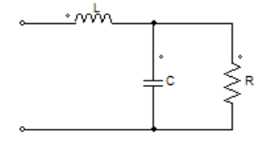 
  <em>Figure 12 : Charge RLC.</em>

Impédance équivalente de l'ensemble C // R :

$$Z_{eq} = \frac{R \cdot \frac{1}{pC}}{R + \frac{1}{pC}} = \frac{R}{pRC + 1}$$

Pont diviseur de tension pour obtenir la fonction de transfert :

$$\frac{V_{out}}{U} = \frac{\frac{R}{pRC+1}}{\frac{R}{pRC+1} + pL} = \frac{R}{p^2 RLC + pL + R} = \frac{1}{p^2 LC + p\frac{L}{R} + 1}$$

Par identification avec un système du second ordre :

$$f_0 = \frac{1}{2\pi\sqrt{LC}} \qquad\text{et}\qquad m = \frac{L}{2R}\cdot\frac{1}{\sqrt{LC}}$$

  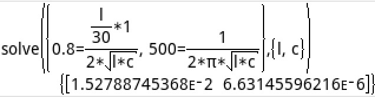 
  <em>Figure 13 : Résolution de L et C.</em>

$$L = 15.28\ \text{mH} \qquad\text{et}\qquad C = 6.63\ \mu\text{F}$$

#### Simulations

  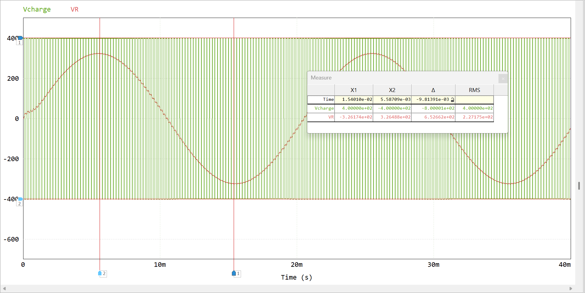 
  <em>Figure 14 : Tension entre bras de pont et aux bornes de R.</em>

  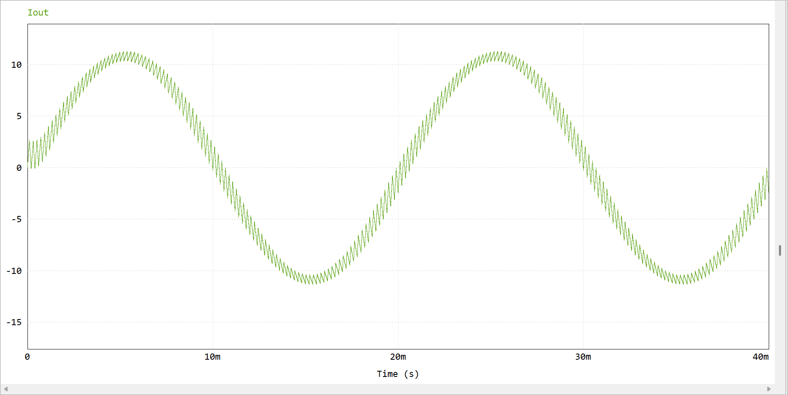 
  <em>Figure 15 : Courant dans l'inductance L.</em>

  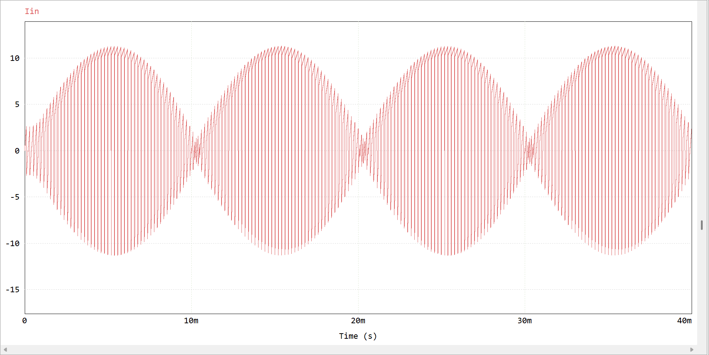 
  <em>Figure 16 : Courant débité par la source VDC.</em>

#### Tension entre bras filtrée

  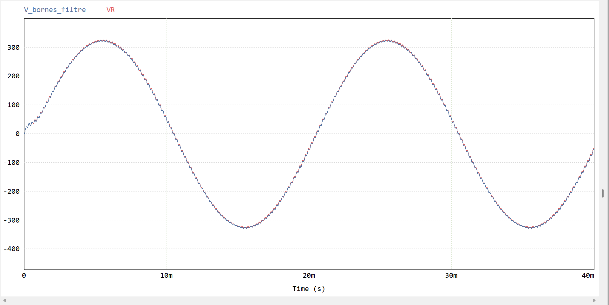 
  <em>Figure 17 : Comparaison entre la tension entre bras filtrée et la tension à la charge.</em>

#### FFT

  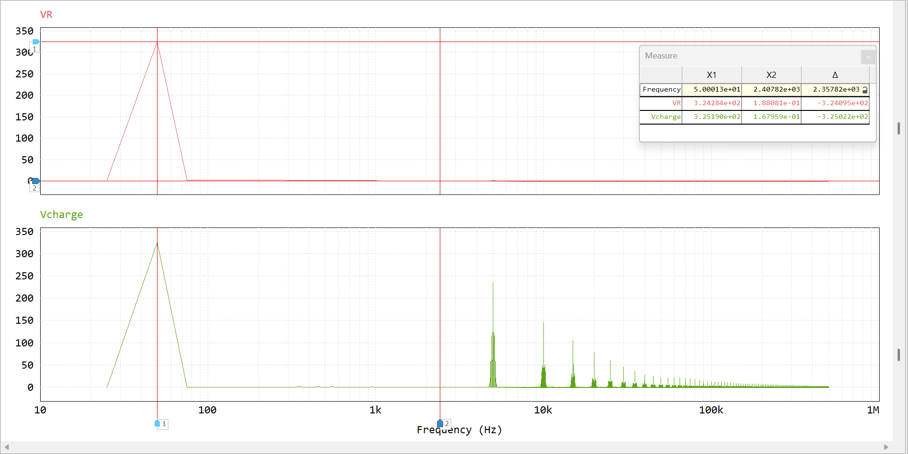 
  <em>Figure 18 : FFT de la tension aux bornes de la charge (V R) et de la tension entre les bras de pont (V charge).</em>

Le filtre LC fonctionne comme prévu : il supprime les harmoniques au-delà de sa fréquence de coupure de 500 Hz (figure 18, graphique du haut).

### c. Onduleur MLI à commandes décalées

  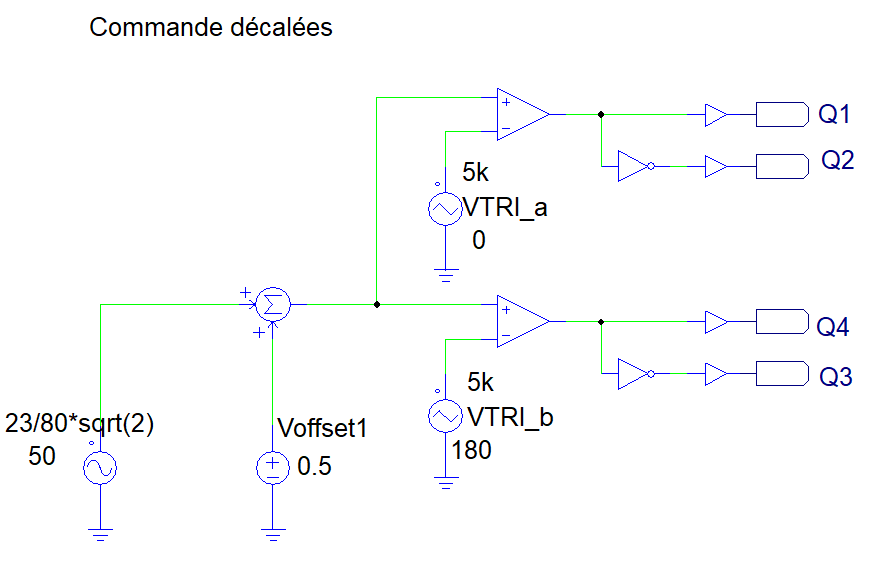 
  <em>Figure 19 : Schéma de commande permettant de générer une commande décalée des interrupteurs.</em>

#### Simulations

  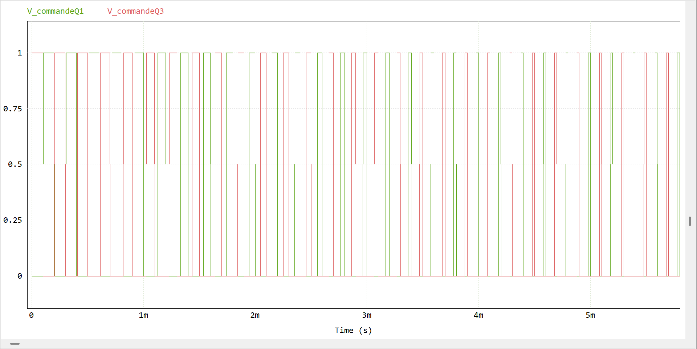 
  <em>Figure 20 : PWM pour contrôler les interrupteurs T1 et T3 (commandes décalées).</em>

  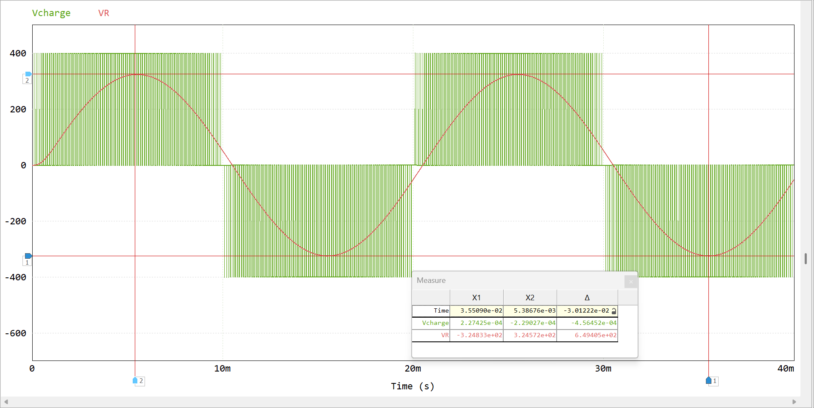 
  <em>Figure 21 : Tension entre bras de pont Vcharge  et aux bornes de la charge VR  (commandes décalées).</em>

  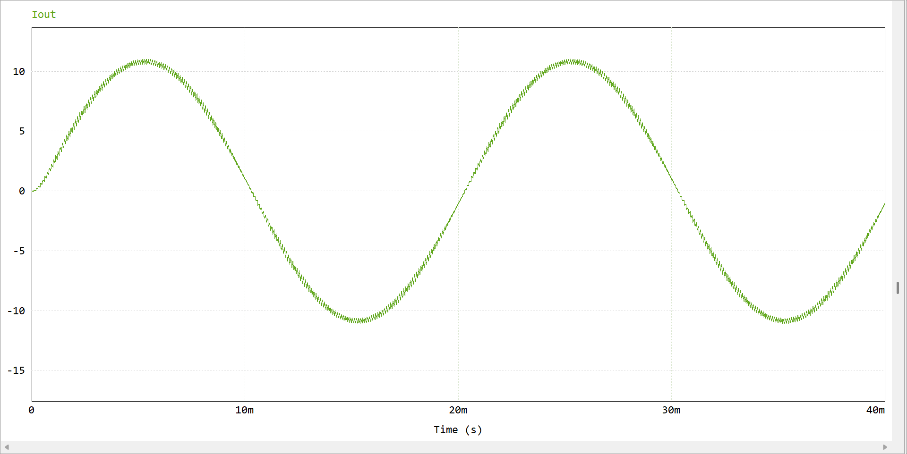 
  <em>Figure 22 : Courant dans l'inductance (commandes décalées).</em>

  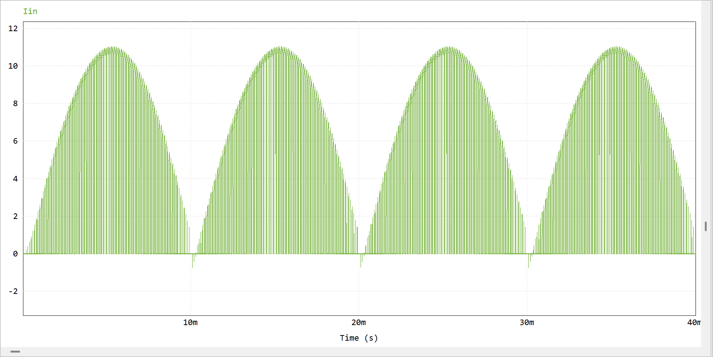 
  <em>Figure 23 : Courant débité par la source VDC  (commandes décalées).</em>

#### Tension entre bras filtrée

  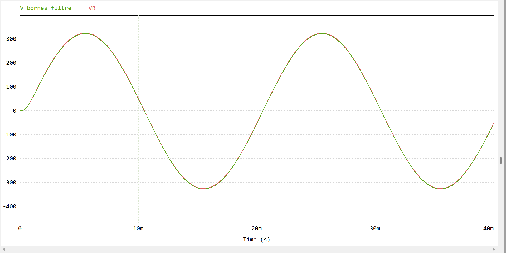 
  <em>Figure 24 : Tensions entre bras filtrée et de sortie (commandes décalées).</em>

#### FFT

  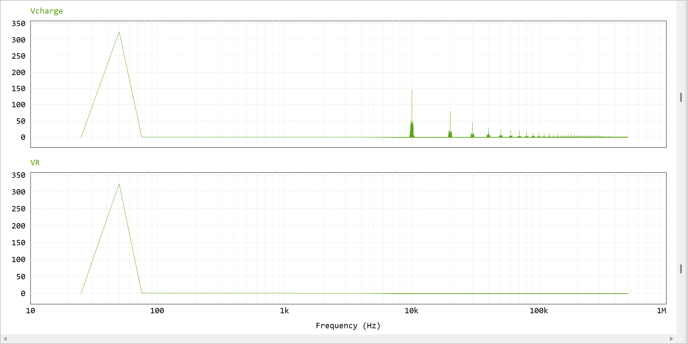 
  <em>Figure 25 : FFT de la tension aux bornes de la charge (VR ) et de la tension entre les bras de pont (Vcharge ) (commandes décalées).</em>

En comparant avec les commandes complémentaires totales, on constate qu'avec des commandes décalées les harmoniques commencent à **10 kHz** au lieu de **5 kHz**.

### d. Réversibilité redresseur / onduleur

  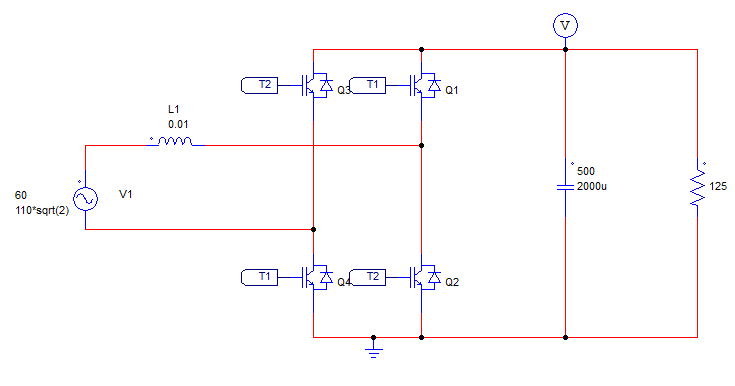 
  <em>Figure 26 : Étude du fonctionnement en redresseur MLI — boucle ouverte.</em>

On calcule le rapport cyclique pour que :

1. la puissance transférée de $V_1$ vers la résistance de charge soit de **2 kW** ;
2. la tension $V_{DC}$ aux bornes de la résistance soit de **500 V** ;
3. le courant $I_1$ (débité par $V_1$) soit **en phase** avec la tension $V_1$.

  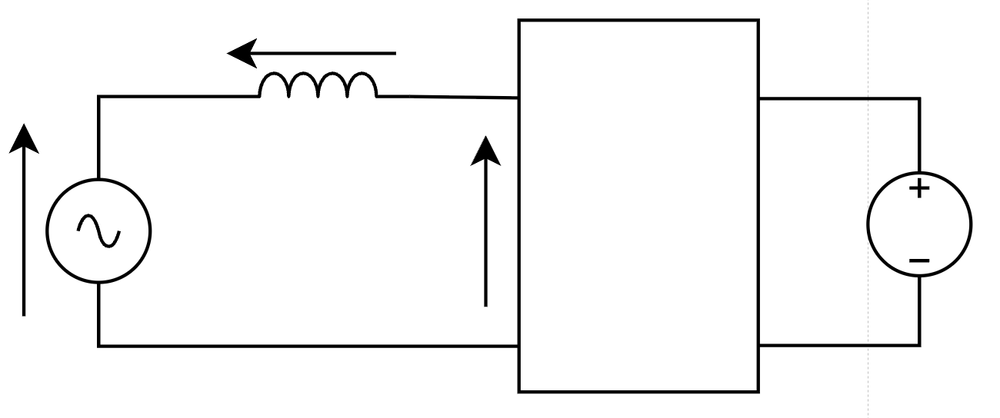 
  <em>Figure 27 : Schéma d'un onduleur réversible.</em>

$$U = V_o + jL\omega I \qquad\Rightarrow\qquad V_o = U - jL\omega I$$

  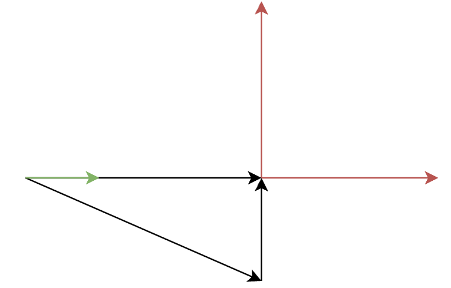 
  <em>Figure 28 : Diagramme de Fresnel du redresseur.</em>

Le courant et la tension doivent être en phase, donc $\cos\varphi = 1$ et :

$$I = \frac{P}{U} = \frac{2000}{110} = 18.18\ \text{A}$$

Déphasage entre $U$ et $V_o$ (source à 60 Hz) :

$$\theta = \arg(V_o) = \arctan\!\left(\frac{-L\omega I}{U}\right) = -31.92^\circ$$

Pour obtenir $V_{DC} = 500$ V :

$$V_o = \frac{2\, V_{DC}\, \delta\alpha}{\sqrt{2}} \quad\Rightarrow\quad \delta\alpha = \frac{V_o \sqrt{2}}{2\, V_{DC}} = \frac{\sqrt{U^2 + (L\omega I)^2}\,\sqrt{2}}{2\, V_{DC}}$$

$$\delta\alpha = \frac{\sqrt{110^2 + (0.01 \times 2\pi \times 60 \times 18.18)^2}\;\sqrt{2}}{2 \times 500} = 0.183$$

#### Fonctionnement en boucle ouverte

  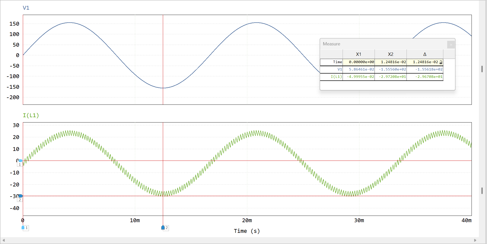 
  <em>Figure 29 : Tension V1  et courant IL1 ) en boucle ouverte.</em>

  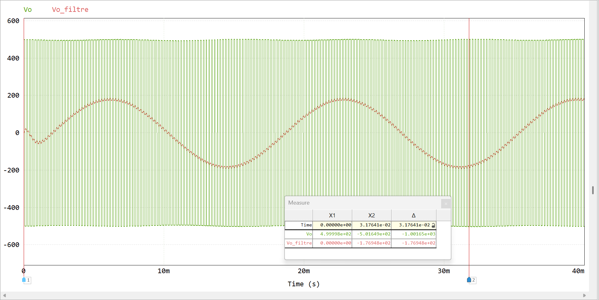 
  <em>Figure 30 : Tension Vo (entre bras) et sa version filtrée Vo_filtre .</em>

  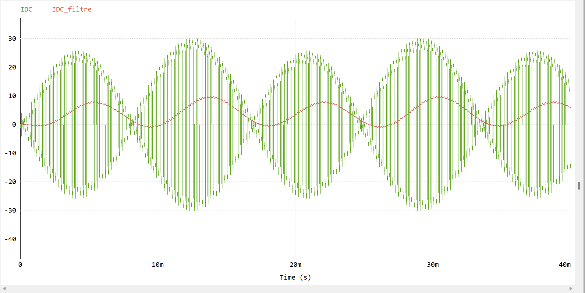 
  <em>Figure 31 : Courant IDC  et sa version filtrée IDC_filtre.</em>

  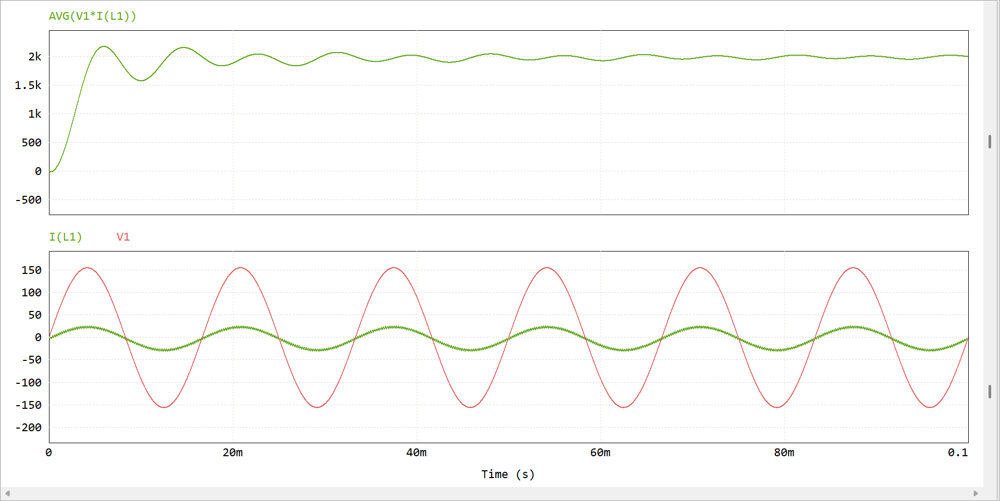 
  <em>Figure 32 : Puissance moyenne côté réseau, courant IL 1 et tension V1 .</em>

  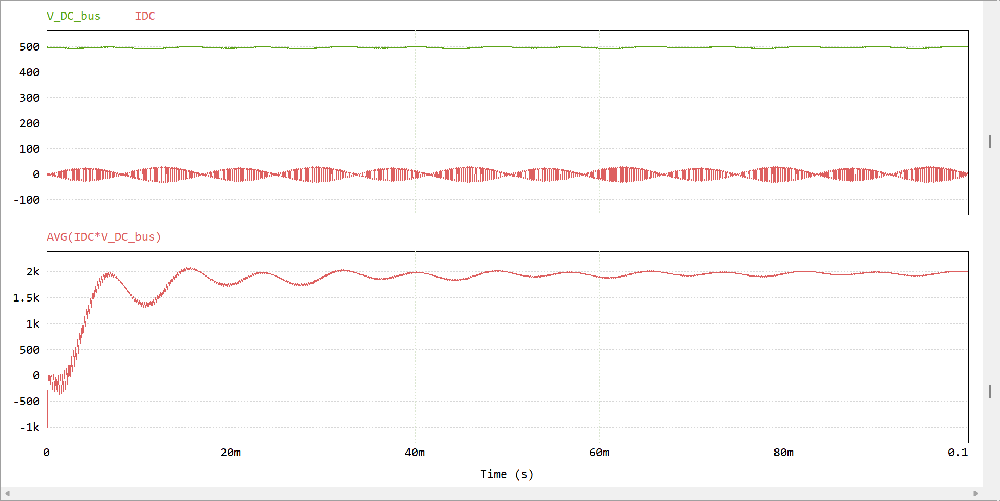 
  <em>Figure 33 : Tension du bus continu VDC_bus , courant IDC  et puissance moyenne.</em>

  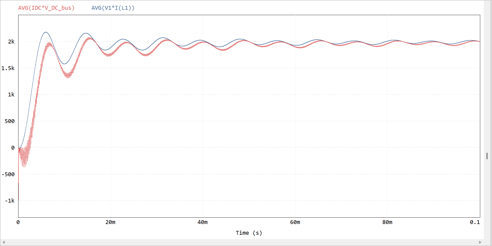 
  <em>Figure 34 : Comparaison des puissances moyennes côté alternatif et côté continu.</em>

#### Asservissement du courant

  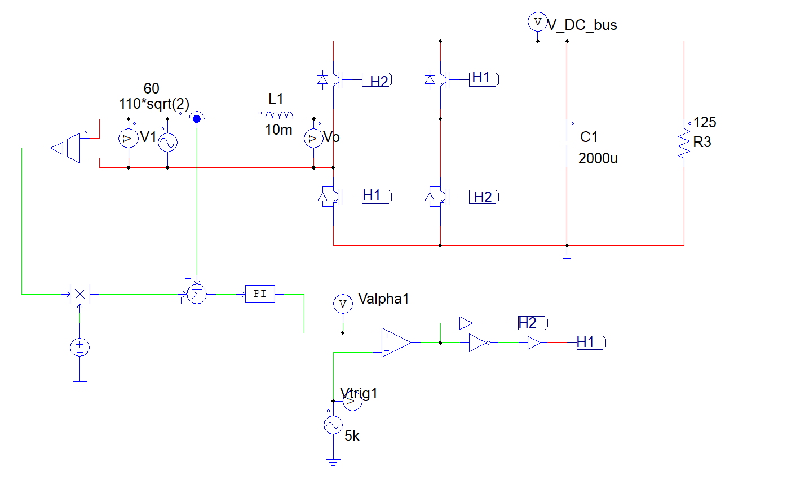 
  <em>Figure 35 : Schéma de simulation avec boucle de courant (régulateur PI et génération du rapport cyclique).</em>

  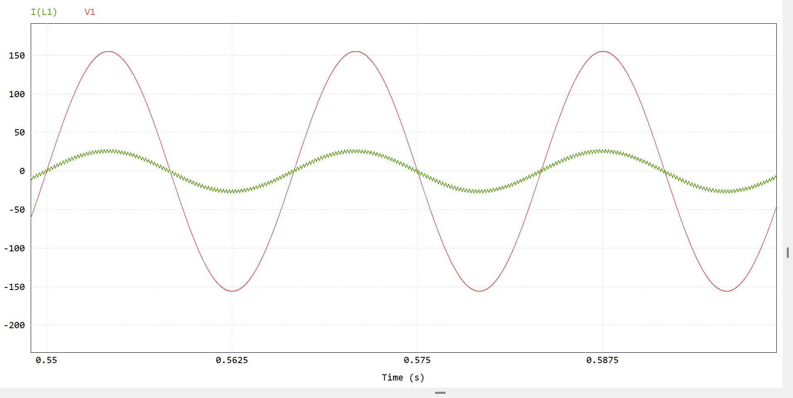 
  <em>Figure 36 : Courant IL1  et tension V1  en régime établi.</em>

  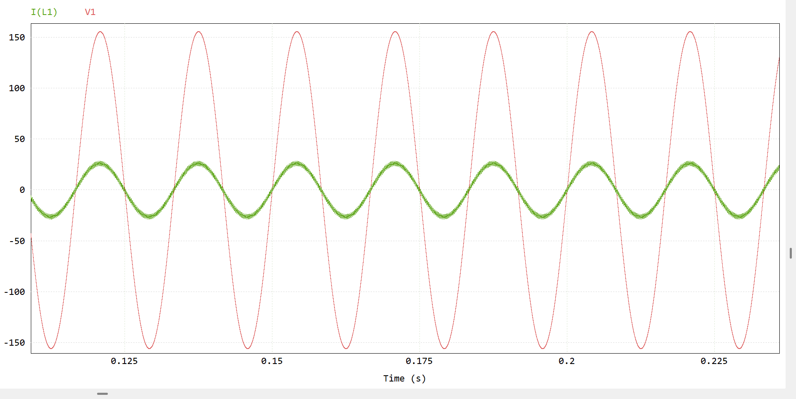 
  <em>Figure 37 : Courant IL1  et tension V1  (échelle de temps plus large).</em>

  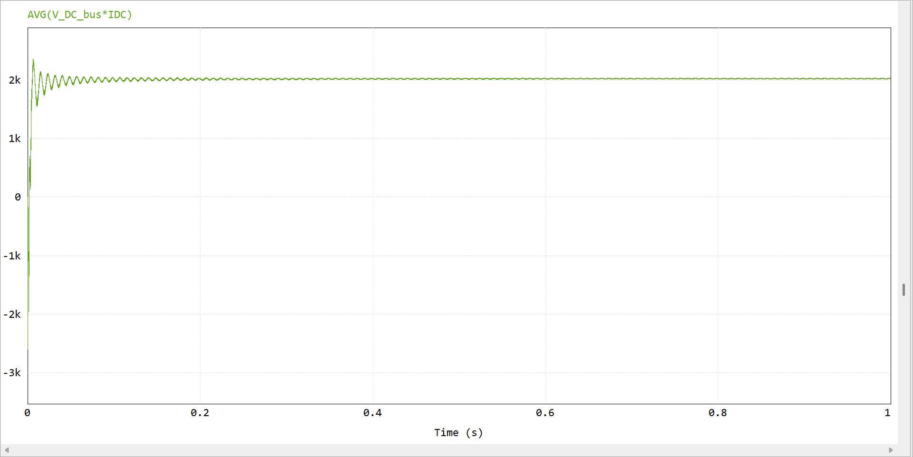 
  <em>Figure 38 : Puissance moyenne.</em>

  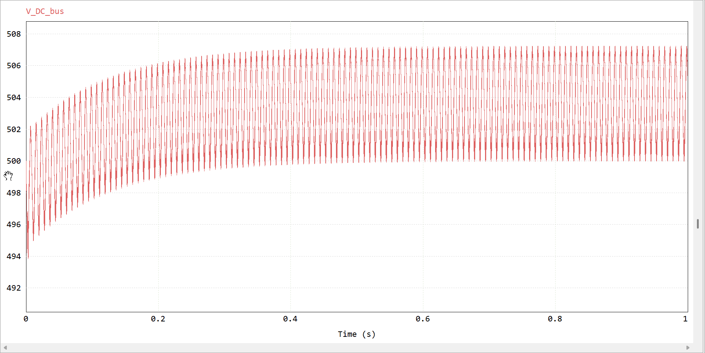 
  <em>Figure 39 : Tension du bus continu VDC_bus  (ondulation autour de 500 V).</em>

#### Boucle de tension et de courant

  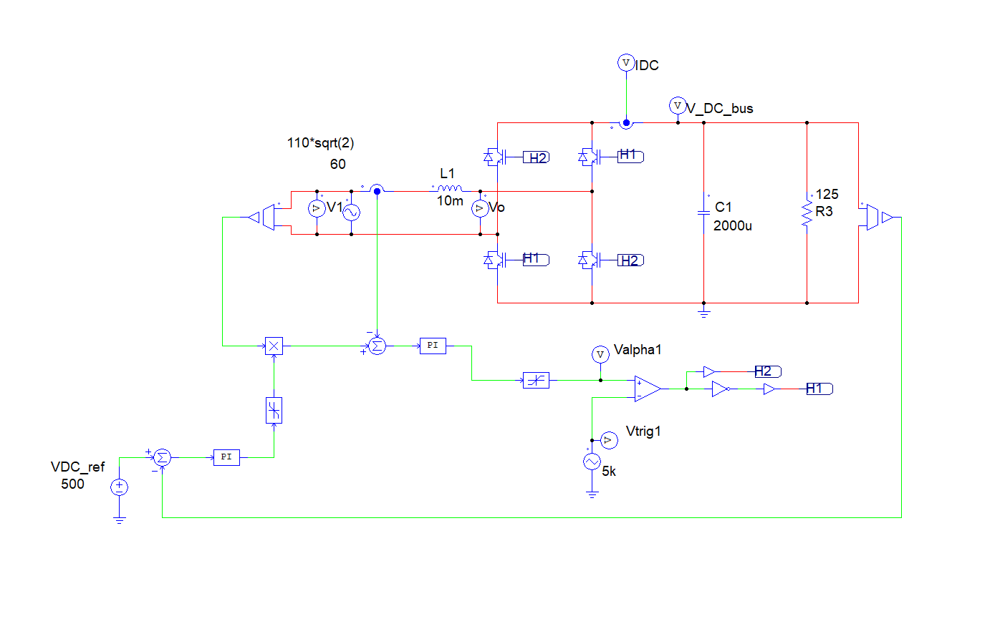 
  <em>Figure 40 : Schéma de simulation avec boucle de tension (externe) et boucle de courant (interne).</em>

**Charge 125 Ω**

  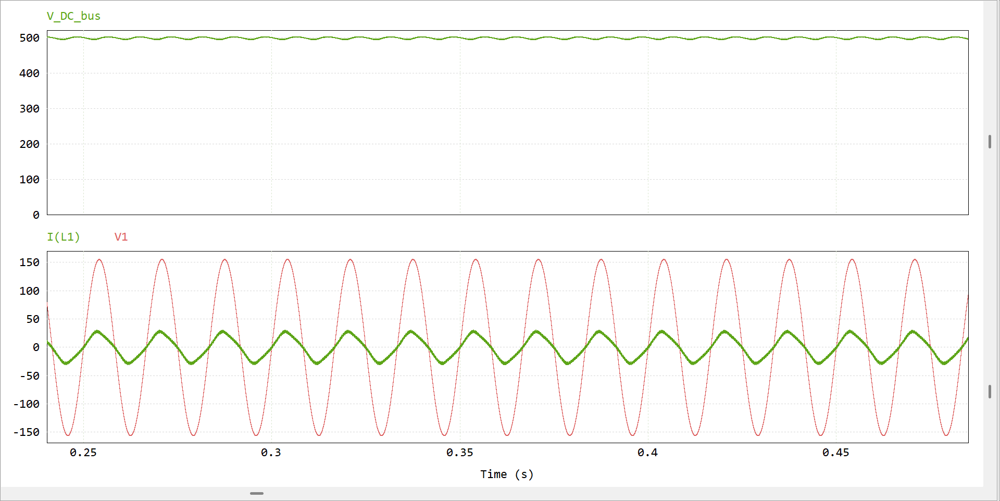 
  <em>Figure 41 : Tension du bus continu, courant IL1  et tension V1  (charge 125 Ω).</em>

  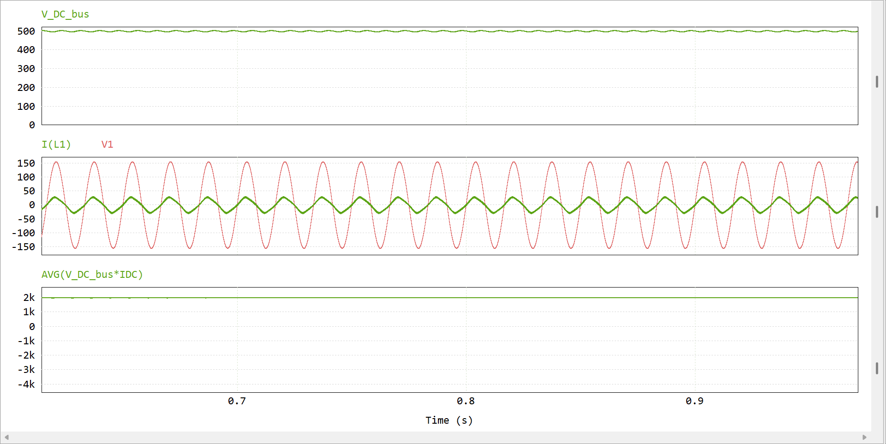 
  <em>Figure 42 : Tension du bus continu, courant, tension V1  et puissance moyenne (charge 125 Ω).</em>

**Charge 250 Ω**

  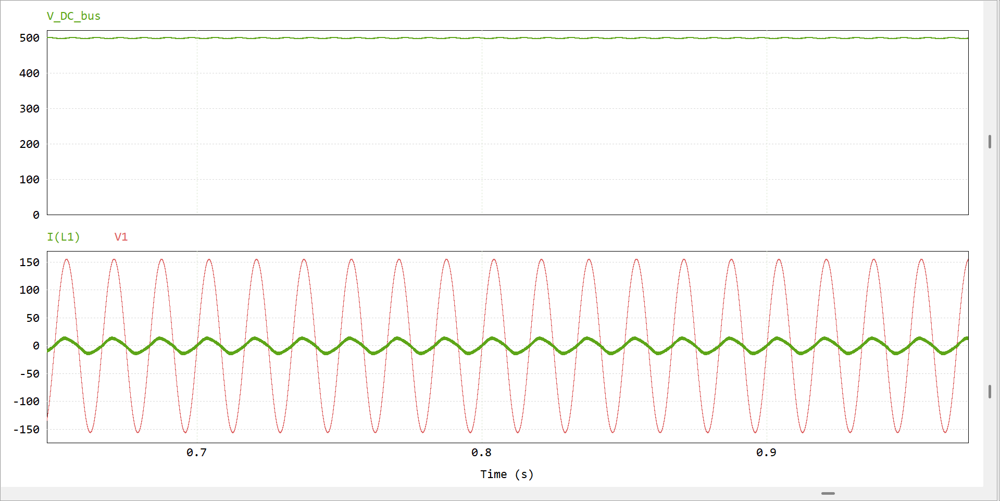 
  <em>Figure 43 : Tension du bus continu, courant VL1  et tension V1  (charge 250 Ω).</em>

  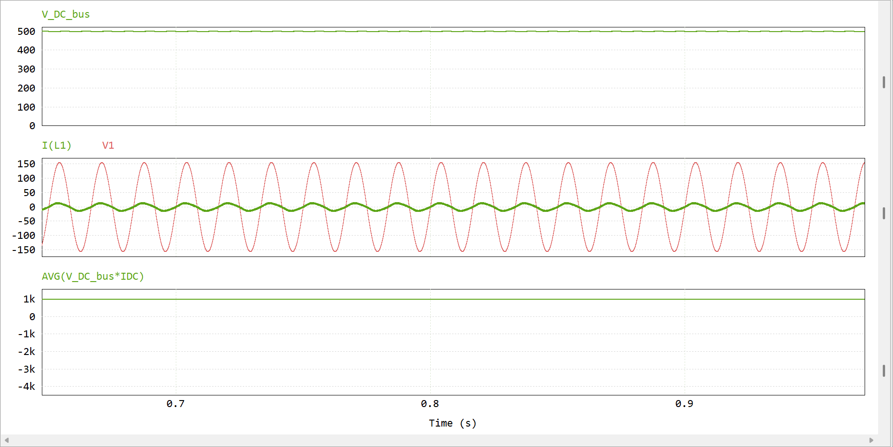 
  <em>Figure 44 : Tension du bus continu, courant, tension V1  et puissance moyenne (charge 250 Ω).</em>

---

## 2. Onduleur triphasé

### a. Simulations avec charge RL

  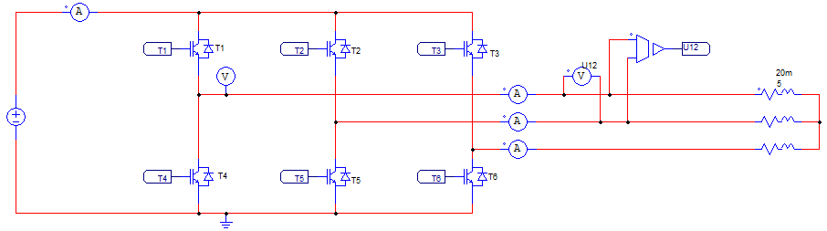 
  <em>Figure 45 : Schéma de puissance d'un onduleur triphasé avec une charge RL.</em>

  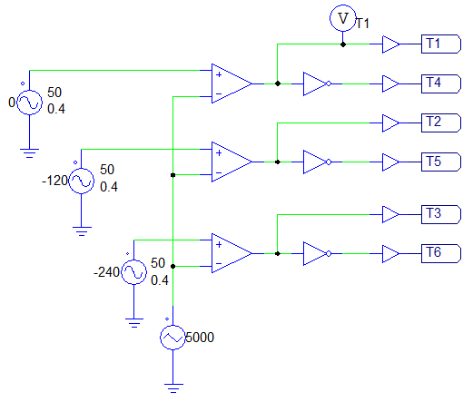 
  <em>Figure 46 : Logique de commande des interrupteurs de l'onduleur triphasé.</em>

Pour commander les interrupteurs d'un onduleur triphasé, il faut 3 signaux modulants déphasés de 120° les uns par rapport aux autres (un par bras). Chaque rapport cyclique est de la forme :

$$\alpha(t) = \alpha_0 + \delta\alpha \sin(\Omega t + \varphi)$$

- $\alpha_0$ : offset du rapport cyclique ($\alpha_0 = 0.5$) ;
- $\delta\alpha$ : amplitude maximale du rapport cyclique ($\delta\alpha = 0.4$) ;
- $\Omega$ : pulsation du signal ;
- $\varphi$ : déphasage du signal (0°, −120°, −240°).

Chaque signal est comparé à un signal triangulaire de fréquence de découpage **5 kHz** pour générer la commande des transistors.

  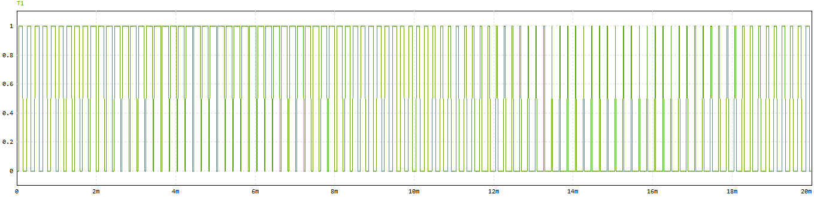 
  <em>Figure 47 : Commande de T1.</em>

  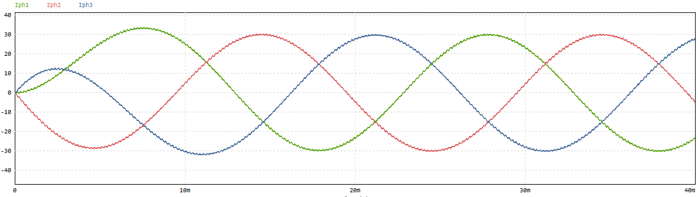 
  <em>Figure 48 : Les trois courants de charge.</em>

  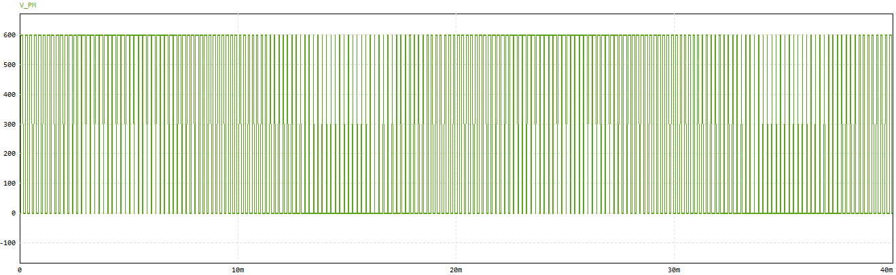 
  <em>Figure 49 : Tension entre le point milieu du premier bras (T1/T4) et la masse.</em>

   
  <em>Figure 50 : Tension composée $U_{12}$.</em>

   
  <em>Figure 51 : Courant prélevé sur l'alimentation $I_{in}$.</em>

On obtient trois courants sinusoïdaux grâce à la fréquence de découpage élevée. Ils sont équilibrés, ce qui est dû à la charge équilibrée, et le courant maximal prélevé concorde avec l'amplitude des courants de phase.

La tension entre le point milieu du bras T1/T4 et la masse varie bien entre 0 et 600 V, exactement synchronisée avec le signal de commande de T1. La tension composée $U_{12}$ varie bien entre $0$ et $\pm V_{DC}$.

   
  <em>Figure 52 : Mesure de la tension composée $U_{12}$ avec un filtre passe-bas du 1er puis du 2ème ordre (fréquence de coupure 500 Hz).</em>

   
  <em>Figure 53 : Valeurs efficaces de la tension composée $U_{12}$ (en bleu) avec les 2 filtres.</em>

Ces mesures sont cohérentes avec la formule théorique de la valeur efficace d'une tension composée d'un onduleur triphasé :

$$U_{eff} = \frac{\sqrt{3}}{\sqrt{2}}\, \delta\alpha\, V_{DC}$$

   
  <em>Figure 54 : $U_{eff\_filtrée}$ en fonction de &delta;&alpha;.</em>

La relation entre $U_{eff\_filtrée}$ et $\delta\alpha$ est proportionnelle et linéaire, ce qui confirme la formule.

#### Cas $\delta\alpha = 2$

   
  <em>Figure 55 : Commande de T1 et trois courants de charge ($\delta\alpha = 2$).</em>

   
  <em>Figure 56 : Tension entre le point milieu du bras 1 et la masse, tension composée $U_{12}$ et courant sur l'alimentation $I_{in}$ ($\delta\alpha = 2$).</em>

Avec $\delta\alpha = 2$, on constate une **saturation** du courant et des tensions par rapport aux mesures avec $\delta\alpha = 0.4$ : $\delta\alpha$ est trop élevé.

#### Influence de la fréquence de découpage

   
  <em>Figure 57 : Courant de charge de la phase 1 et tension $U_{12}$ après filtrage par un passe-bas du 1er ordre (fréquence de découpage 5 kHz).</em>

   
  <em>Figure 58 : FFT du courant de charge et de la tension $U_{12}$ après filtrage (fréquence de découpage 5 kHz).</em>

   
  <em>Figure 59 : Courant de charge de la phase 1 et tension $U_{12}$ après filtrage par un passe-bas du 1er ordre (fréquence de découpage 500 Hz).</em>

   
  <em>Figure 60 : FFT du courant de charge et de la tension $U_{12}$ après filtrage (fréquence de découpage 500 Hz).</em>

Changer la fréquence de découpage permet de contrôler le nombre d'harmoniques : plus on l'augmente, moins il y en a.

#### Influence de $\alpha_0$

   
  <em>Figure 61 : Courants de charge avec $\alpha_0 = 0.4,\ 0.5,\ 0.6$.</em>

   
  <em>Figure 62 : Tension composée $U_{12}$ avec $\alpha_0 = 0.4,\ 0.5,\ 0.6$.</em>

   
  <em>Figure 63 : Courant prélevé sur l'alimentation $I_{in}$ avec $\alpha_0 = 0.4,\ 0.5,\ 0.6$.</em>

Même en changeant $\alpha_0$, on obtient à peu près les mêmes courbes pour les courants de phase, la tension composée $U_{12}$ et le courant prélevé sur l'alimentation $I_{in}$.

### b. Simulation sur machine asynchrone

La charge de l'onduleur est maintenant une machine asynchrone à cage (*Squirrel Cage Induction Machine*) associée à une charge mécanique (*Mechanical Load (general)*).

   
  <em>Figure 64 : Schéma de simulation de l'onduleur triphasé alimentant la machine asynchrone.</em>

#### Cas $\delta\alpha = 0.5$

   
  <em>Figure 65 : Courants des phases du moteur ($\delta\alpha = 0.5$).</em>

Pour le rapport du courant de démarrage sur le courant de régime établi ($I_d / I_n$), on prend comme valeur de $I_d$ la valeur efficace juste après le tout début du démarrage :

$$\frac{I_d}{I_n} = \frac{14}{3.84} = 3.65$$

   
  <em>Figure 66 : Vitesse de rotation du moteur ($\delta\alpha = 0.5$).</em>

   
  <em>Figure 67 : Couple instantané et couple moyenné sur l'arbre ($\delta\alpha = 0.5$).</em>

   
  <em>Figure 68 : Puissance mécanique moyennée ($\delta\alpha = 0.5$).</em>

   
  <em>Figure 69 : Puissance électrique instantanée absorbée par l'onduleur ($\delta\alpha = 0.5$).</em>

   
  <em>Figure 70 : Vitesse et accélération du moteur ($\delta\alpha = 0.5$).</em>

Le temps d'accélération est d'environ **0,77 s**.

#### Cas $\delta\alpha = 0.3$

Lors de la première simulation, le régime permanent n'était pas atteint ; la simulation a donc été allongée à 6 secondes.

   
  <em>Figure 71 : Courants des phases du moteur ($\delta\alpha = 0.3$).</em>

$$\frac{I_d}{I_n} = \frac{8.35}{3.81} = 2.19$$

   
  <em>Figure 72 : Vitesse de rotation du moteur ($\delta\alpha = 0.3$).</em>

   
  <em>Figure 73 : Couple instantané et couple moyenné sur l'arbre ($\delta\alpha = 0.3$).</em>

   
  <em>Figure 74 : Puissance mécanique moyennée ($\delta\alpha = 0.3$).</em>

   
  <em>Figure 75 : Puissance électrique instantanée absorbée par l'onduleur ($\delta\alpha = 0.3$).</em>

   
  <em>Figure 76 : Vitesse et accélération du moteur ($\delta\alpha = 0.3$).</em>

Le temps d'accélération est d'environ **3,87 s**.

#### Comparaison

| | $\delta\alpha = 0.5$ | $\delta\alpha = 0.3$ |
|---|:---:|:---:|
| Rapport $I_d / I_n$ | 3.65 | 2.19 |
| Temps d'accélération (s) | 0.77 | 3.87 |

$\delta\alpha$ influence à la fois le temps d'accélération et le courant de démarrage demandé par le moteur. On observe aussi un dépassement plus important de la puissance mécanique moyennée pour $\delta\alpha = 0.5$ que pour $\delta\alpha = 0.3$.

#### Inversion du sens de rotation

Pour changer le sens de rotation, on inverse l'ordre de deux des trois phases (séquence directe ABC → séquence inverse ACB), ce qui inverse instantanément le sens de rotation du champ magnétique statorique.

On laisse la phase A telle quelle et on ajoute deux multiplexeurs pour les phases B et C : à t = 1,1 s, un échelon passe de 0 à 1 V, ce qui fait changer d'entrée les multiplexeurs et permute donc les commandes des phases B et C.

   
  <em>Figure 77 : Schéma de commande pour l'inversion du sens de rotation du moteur.</em>

   
  <em>Figure 78 : Couple moyenné sur l'arbre, vitesse de rotation du moteur et puissance mécanique moyennée.</em>

   
  <em>Figure 79 : Courants de phases du moteur.</em>

   
  <em>Figure 80 : Courants de phases du moteur lors de l'inversion des phases B et C.</em>

Observations :

- La vitesse de rotation diminue jusqu'à devenir négative puis atteint sa valeur maximale négative : le sens de rotation s'est bien inversé.
- Le couple moyenné sur l'arbre a à peu près la même allure à vitesse négative qu'à vitesse positive.
- La puissance mécanique devient négative pendant le freinage, puis a exactement la même allure pendant l'accélération en sens inverse que pendant l'accélération en sens direct.
- Le courant met à peu près le double de temps pour atteindre le régime permanent, ce qui est normal puisque le moteur passe de −vitesse max à +vitesse max. À 1,1 s, la phase A ne change pas brusquement tandis que les phases B et C changent soudainement, à cause de la permutation des phases B et C.
- La valeur efficace du courant après permutation ressemble à celle du démarrage, à cause du couple nécessaire pour freiner le moteur puis l'accélérer jusqu'à la vitesse maximale négative ; elle redevient égale au courant RMS du régime permanent.

---

## Outils

- Simulation : **PSIM**
- Rédaction d'origine : Word (`.docx`) / PDF

Compte rendu réalisé à l'ENSEA — Onduleurs et Qualité de l'énergie.
